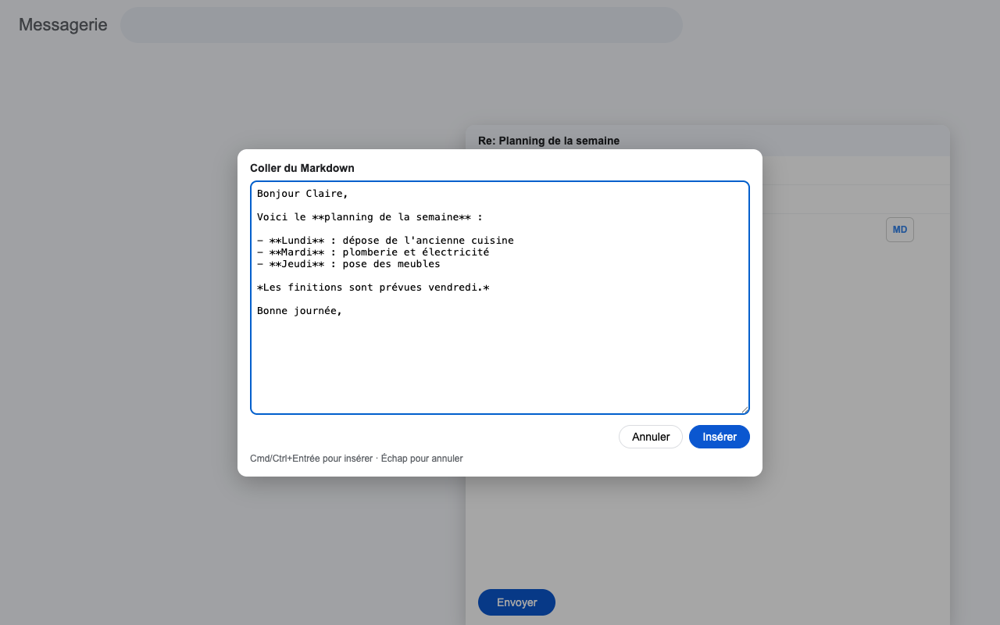
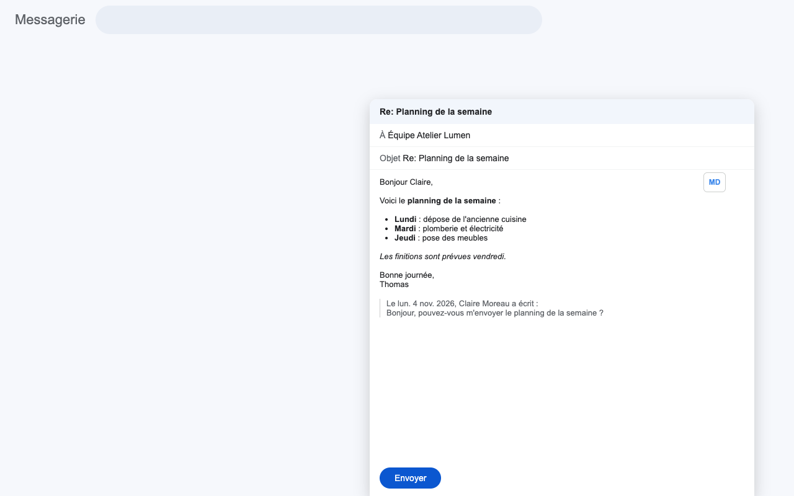

# Markdown2Gmail

Extension Chrome qui colle du Markdown dans un mail Gmail, mis en forme **comme un texte saisi dans Gmail** : même police, mêmes espacements, listes et gras natifs. La signature et l'historique cité restent intacts.

Pratique pour coller une réponse rédigée par une IA (ChatGPT, Claude…) ou un texte préparé en Markdown.





## Utilisation

- Cliquer dans la zone de rédaction d'un mail Gmail
- Cliquer sur le bouton **MD** en haut à droite de la zone, ou faire **Cmd/Ctrl+Maj+M**
- Coller le Markdown, puis **Insérer** (ou **Cmd/Ctrl+Entrée**)
- Le texte est inséré à l'endroit du curseur, avant la signature et l'historique

Une ligne « Objet : … » en tête du Markdown est ignorée.

## Installation (mode développeur)

```bash
git clone https://github.com/dimer47/markdown2gmail.git
```

- Ouvrir `chrome://extensions`
- Activer le **Mode développeur**
- **Charger l'extension non empaquetée** et choisir le dossier cloné

## Pourquoi une extension plutôt qu'une conversion à copier-coller ?

- Gmail impose son propre HTML : un `<div>` par paragraphe, `<div><br></div>` entre deux blocs, police héritée. Un HTML « classique » (`<p>`, tailles de police) donne deux tailles de texte et des espacements faux.
- Un brouillon créé par l'API Gmail n'a ni la signature, ni l'historique cité. L'extension insère dans le vrai éditeur, donc tout est conservé.

## Fichiers

| Fichier | Rôle |
|---|---|
| `manifest.json` | Manifeste MV3, script injecté sur `mail.google.com` uniquement |
| `convert.js` | `gmdConvert(md)` : Markdown → HTML au format Gmail |
| `content.js` | Bouton MD, raccourci, fenêtre de collage, insertion |
| `content.css` | Styles du bouton et de la fenêtre |
| `marked.min.js` | Bibliothèque [marked](https://github.com/markedjs/marked) |
| `demo/demo.html` | Page de démonstration (fausse fenêtre de rédaction) |

Démo locale :

```bash
python3 -m http.server 8798
# puis http://127.0.0.1:8798/demo/demo.html
```

## Confidentialité

Aucune donnée n'est envoyée : la conversion se fait entièrement dans le navigateur. Aucune autorisation n'est demandée en dehors de l'accès à `mail.google.com`.

## Compatibilité

Le bouton MD se place à gauche du bouton de l'extension [Plume AI](https://github.com/dimer47/plume-ai-chrome-extension) quand les deux sont installées.

## Licence

Markdown2Gmail est publié sous licence [PolyForm Noncommercial 1.0.0](LICENSE.md).

- Usage personnel, associatif, éducatif ou de recherche : libre et gratuit
- Modification et partage : autorisés, hors usage commercial
- Usage commercial (entreprise, revente, intégration dans un produit payant) : licence commerciale obligatoire

Pour une licence commerciale : iachi.dimitri@gmail.com

## Contribuer

Les contributions sont les bienvenues : voir [CONTRIBUTING.md](CONTRIBUTING.md).
